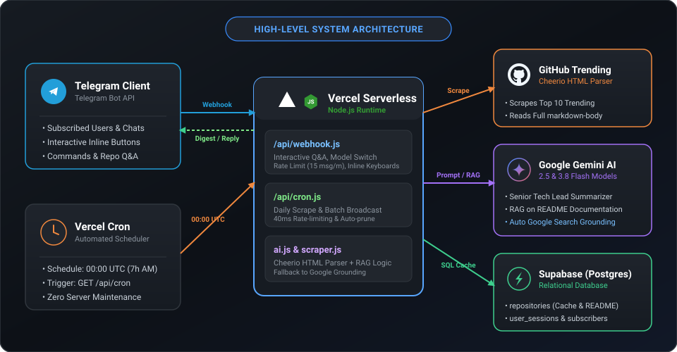
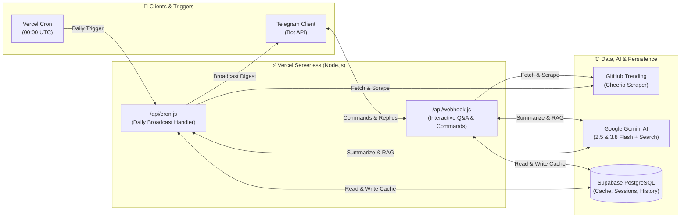

<div align="center">

# ⚡ GitHub Trending Telegram Bot with Gemini AI

<p align="center">
  <strong>An enterprise-grade, serverless Telegram bot that monitors daily GitHub Trending repositories, crafts senior-level architectural insights via Google Gemini Flash, enables RAG-powered interactive repository Q&A, and grounds external questions with live Google Search.</strong>
</p>

<p align="center">
  <a href="https://t.me/YourBotName"></a>
  <a href="https://vercel.com/new/clone?repository-url=https%3A%2F%2Fgithub.com%2Fhm4uc%2Fgithub-trending-telegram-bot&env=BOT_TOKEN,GEMINI_API_KEY,SUPABASE_URL,SUPABASE_KEY"></a>
</p>

<p align="center">
  
  
  
  
  
  <a href="https://github.com/hm4uc/github-trending-telegram-bot/stargazers"></a>
  <a href="https://github.com/hm4uc/github-trending-telegram-bot/network/members"></a>
</p>

> 🇻🇳 **Ghi chú dành cho Lập trình viên Việt Nam:** Mặc định bot biên soạn bản tin, phân tích kỹ thuật và giải đáp hỏi đáp bằng **Tiếng Việt**, với phong cách tóm tắt sắc bén của một *Senior Tech Lead* (không vòng vo, tập trung vào bản chất công nghệ và bài toán giải quyết).

</div>

---

## 📑 Table of Contents

- [Overview & Highlights](#-overview--highlights)
- [Key Features](#-key-features)
- [System Architecture](#-system-architecture)
- [Project Structure](#-project-structure)
- [Bot Commands & Interactive UI](#-bot-commands--interactive-ui)
- [Database Schema (Supabase PostgreSQL)](#-database-schema-supabase-postgresql)
- [Getting Started](#-getting-started)
  - [Prerequisites](#prerequisites)
  - [Installation](#installation)
  - [Database Setup](#database-setup)
  - [Environment Configuration](#environment-configuration)
  - [Running Locally](#running-locally)
- [Production Deployment (Vercel)](#-production-deployment-vercel)
  - [1. Deploy to Vercel](#1-deploy-to-vercel)
  - [2. Set Up Telegram Webhook](#2-set-up-telegram-webhook)
  - [3. Automated Daily Cron](#3-automated-daily-cron)
- [Tech Stack](#-tech-stack)
- [Star History](#-star-history)
- [Contributing & License](#-contributing--license)

---

## 🌟 Overview & Highlights

**GitHub Trending Telegram Bot** is a modern, serverless automation tool built for developers, tech leads, and open-source enthusiasts. It tracks top trending repositories on GitHub each day, extracts their comprehensive `README.md` documentation, analyzes their core architecture using **Google Gemini 2.5 / 3.8 Flash**, and automatically broadcasts curated technical digests to Telegram subscribers.

Beyond automated broadcasts, the bot acts as an **interactive AI documentation assistant**: developers can bind any GitHub repository and perform conversational Q&A grounded directly on the actual codebase documentation (RAG), with automated fallback to **live Google Search** whenever technical questions extend beyond the README scope.

---

## ⚡ Key Features

| Feature | Description |
| :--- | :--- |
| 🕷️ **High-Speed Scraper** | Parallel Cheerio scraper extracting top trending repositories, programming languages, stars, and full markdown body content from GitHub. |
| 🧠 **Dual Gemini AI Engine** | Instant in-chat switching between `gemini-2.5-flash` (ultra-fast, free Google Search grounding) and `gemini-3.8-flash` (deep technical reasoning). |
| 📚 **RAG Repository Q&A** | Chat interactively with any repository’s real documentation using `/ask <owner/repo>` or by simply dropping a GitHub repository link into the chat. |
| 🌐 **Live Google Search Grounding** | Auto-detects out-of-scope queries (`[OUT_OF_SCOPE]`) and seamlessly falls back to real-time Google Search targeted to GitHub and official docs. |
| ⏰ **Serverless Morning Digest** | Automated Vercel Cron triggered daily at 07:00 AM (00:00 UTC), delivering concise, developer-focused tech summaries. |
| 🛡️ **Production-Ready Multi-User Scale** | Built-in rate limiting (15 msgs/min per user), 40ms broadcast throttling (Telegram API compliance), and automatic cleanup for blocked bots (`403 Forbidden`). |
| 🎛️ **Modern Telegram UX** | Interactive Telegram Inline Keyboard buttons, real-time `typing` indicators, and automatic Markdown error recovery with plain-text fallback. |

---

## 🏗️ System Architecture

A high-level architectural overview illustrating how the Telegram Client, Vercel Serverless Platform, Google Gemini AI, Supabase PostgreSQL, and GitHub Trending Scraper integrate cleanly:

<p align="center">
  
</p>

<details>
<summary><b>🔍 View Mermaid Source Code</b></summary>



</details>

---

## 📁 Project Structure

```text
github-trending-telegram-bot/
├── api/
│   ├── cron.js             # Vercel Cron handler: scrapes daily trending & broadcasts to subscribers
│   └── webhook.js          # Telegram Webhook handler: processes commands, callbacks & RAG Q&A
├── ai.js                   # Google Gemini integration (2.5 Flash, 3.8 Flash, Search Grounding)
├── db.js                   # Supabase PostgreSQL client initialization
├── main.js                 # Local execution CLI to scrape and broadcast immediately
├── scraper.js              # Cheerio-based scraper for trending repositories & raw READMEs
├── setup.sql               # PostgreSQL database schema and performance index definitions
├── vercel.json             # Vercel deployment configuration & daily cron schedule
├── package.json            # Project dependencies and metadata
└── .env.example            # Environment variables template
```

---

## 🤖 Bot Commands & Interactive UI

The bot supports both text commands and one-tap **Inline Keyboard Buttons**:

| Command | Action | Inline Button |
| :--- | :--- | :---: |
| `/start`, `/help` | Displays the interactive main menu and registers the user for morning digests. | ✅ |
| `/trending5`, `/trending10` | Retrieves the top 5 or 10 cached trending repositories and summarizes them. | ✅ |
| `/model` | Opens an interactive model switcher (`gemini-2.5-flash` vs `gemini-3.8-flash`). | ✅ |
| `/setmodel <name>` | Sets the active AI model for the current user session. | - |
| `/status` | Shows the current active repository session and selected AI model. | ✅ |
| `/ask <owner/repo>` | Connects to a specific repository in the database for RAG Q&A (e.g., `/ask commaai/openpilot`). | - |
| *Send GitHub URL* | Paste any GitHub link (e.g., `https://github.com/vllm-project/vllm`) to scrape, save, and start chatting. | - |
| `/subscribe` | Activates daily automated morning broadcasts (07:00 AM ICT). | ✅ |
| `/unsubscribe` | Pauses daily automated broadcasts while keeping full interactive access. | ✅ |
| `/exit`, `/clear` | Exits the active repository session and returns to free-form AI chat. | ✅ |

---

## 🗄️ Database Schema (Supabase PostgreSQL)

The project leverages Supabase PostgreSQL for persistence, session isolation, and fast retrieval:

```sql
-- 1. Repositories cache (scraped metadata and full README text)
CREATE TABLE IF NOT EXISTS repositories (
    id SERIAL PRIMARY KEY,
    repo_name VARCHAR(255) UNIQUE NOT NULL,
    link TEXT NOT NULL,
    description TEXT,
    readme TEXT,
    language VARCHAR(100),
    scraped_at TIMESTAMP WITH TIME ZONE DEFAULT CURRENT_TIMESTAMP
);

-- 2. User sessions (active repository context and per-user model choice)
CREATE TABLE IF NOT EXISTS user_sessions (
    chat_id BIGINT PRIMARY KEY,
    active_repo VARCHAR(255),
    selected_model VARCHAR(100) DEFAULT 'gemini-2.5-flash',
    last_active TIMESTAMP WITH TIME ZONE DEFAULT CURRENT_TIMESTAMP
);

-- 3. Subscribers (automated daily broadcast distribution list)
CREATE TABLE IF NOT EXISTS subscribers (
    chat_id BIGINT PRIMARY KEY,
    username VARCHAR(255),
    first_name VARCHAR(255),
    is_active BOOLEAN DEFAULT TRUE,
    subscribed_at TIMESTAMP WITH TIME ZONE DEFAULT CURRENT_TIMESTAMP
);

-- 4. Chat history (multi-turn conversational context)
CREATE TABLE IF NOT EXISTS chat_history (
    id SERIAL PRIMARY KEY,
    chat_id BIGINT NOT NULL,
    role VARCHAR(50) NOT NULL, -- 'user' or 'model'
    content TEXT NOT NULL,
    created_at TIMESTAMP WITH TIME ZONE DEFAULT CURRENT_TIMESTAMP
);
```

> **Performance Indexes:** Pre-indexed on `chat_history(chat_id, created_at DESC)`, `repositories(scraped_at DESC)`, and `subscribers(is_active)`.

---

## 🚀 Getting Started

### Prerequisites

- **Node.js**: `v20.6.0+` (supports native `.env` loading).
- **Telegram Bot Token**: Created via [@BotFather](https://t.me/BotFather).
- **Google Gemini API Key**: Acquired via [Google AI Studio](https://aistudio.google.com/).
- **Supabase Account**: A free cloud project on [Supabase](https://supabase.com/).

### Installation

1. Clone the repository:
   ```bash
   git clone https://github.com/hm4uc/github-trending-telegram-bot.git
   cd github-trending-telegram-bot
   ```

2. Install dependencies:
   ```bash
   npm install
   ```

### Database Setup

1. Open your Supabase Dashboard -> **SQL Editor**.
2. Paste the contents of [`setup.sql`](./setup.sql) and execute the query to provision all tables and indexes.

### Environment Configuration

Create a `.env` file in the root directory:

```env
# Telegram Bot Configuration
BOT_TOKEN=your_telegram_bot_token
CHAT_ID=your_personal_or_channel_chat_id # Required for local test script

# Google Gemini AI Configuration
GEMINI_API_KEY=your_google_gemini_api_key
GEMINI_MODEL=gemini-2.5-flash # Optional default (gemini-2.5-flash or gemini-3.8-flash)

# Supabase PostgreSQL Configuration
SUPABASE_URL=https://your-project-id.supabase.co
SUPABASE_KEY=your_supabase_service_role_key
```

### Running Locally

To manually trigger a live scraping run, generate AI summaries, and dispatch a test message to your configured `CHAT_ID`:

```bash
node main.js
```

---

## ☁️ Production Deployment (Vercel)

Deploying as a serverless application on Vercel is free, zero-maintenance, and fully automated.

### 1. Deploy to Vercel

Click the button below or import your GitHub repository into the Vercel Dashboard:

[](https://vercel.com/new/clone?repository-url=https%3A%2F%2Fgithub.com%2Fhm4uc%2Fgithub-trending-telegram-bot&env=BOT_TOKEN,GEMINI_API_KEY,SUPABASE_URL,SUPABASE_KEY)

In your Vercel Project Settings -> **Environment Variables**, define:
- `BOT_TOKEN`
- `GEMINI_API_KEY`
- `SUPABASE_URL`
- `SUPABASE_KEY`
- `CHAT_ID` *(optional fallback)*

### 2. Set Up Telegram Webhook

Once your Vercel deployment URL is ready (e.g., `https://your-project.vercel.app`), register the webhook endpoint with Telegram:

```text
https://api.telegram.org/bot<YOUR_BOT_TOKEN>/setWebhook?url=https://<YOUR_VERCEL_URL>/api/webhook
```

Open this URL in your web browser. You should receive a confirmation response:
```json
{ "ok": true, "result": true, "description": "Webhook was set" }
```

### 3. Automated Daily Cron

The `vercel.json` file configures an automatic cron trigger:

```json
{
  "crons": [
    {
      "path": "/api/cron",
      "schedule": "0 0 * * *"
    }
  ]
}
```

Every day at **00:00 UTC** (07:00 AM ICT), Vercel automatically invokes `/api/cron`, scraping the latest trends, generating the AI digest, and broadcasting it to all active subscribers.

---

## 🛠️ Tech Stack

| Technology | Role & Justification |
| :--- | :--- |
| **Node.js (ESM)** | Fast, non-blocking asynchronous execution and modern ECMAScript Module support. |
| **Cheerio** | Lightweight and fast server-side HTML parsing for GitHub Trending & README DOM extraction. |
| **Google Gemini API** | Advanced reasoning via `gemini-2.5-flash` & `gemini-3.8-flash` with native Google Search Grounding. |
| **Supabase (PostgreSQL)** | Reliable relational persistence, ACID guarantees, and instant serverless connection pooling. |
| **Telegram Bot API** | Global messaging infrastructure with rich markdown rendering, inline keyboards, and typing feedback. |
| **Vercel Serverless** | Zero-cold-start edge endpoints and built-in global cron scheduling without dedicated server costs. |

---

## 📈 Star History

[](https://star-history.com/#hm4uc/github-trending-telegram-bot&Date)

---

## 🤝 Contributing & License

Contributions, feedback, and pull requests are warmly welcomed! Please feel free to open an issue or submit a PR:

1. Fork the Project (`https://github.com/hm4uc/github-trending-telegram-bot/fork`)
2. Create your Feature Branch (`git checkout -b feat/amazing-feature`)
3. Commit your Changes (`git commit -m 'feat: add amazing feature'`)
4. Push to the Branch (`git push origin feat/amazing-feature`)
5. Open a Pull Request

This project is licensed under the **ISC License**. See the [LICENSE](./LICENSE) file for more details.

<div align="center">
  <sub>Built with ❤️ for the open-source and developer community.</sub>
</div>
